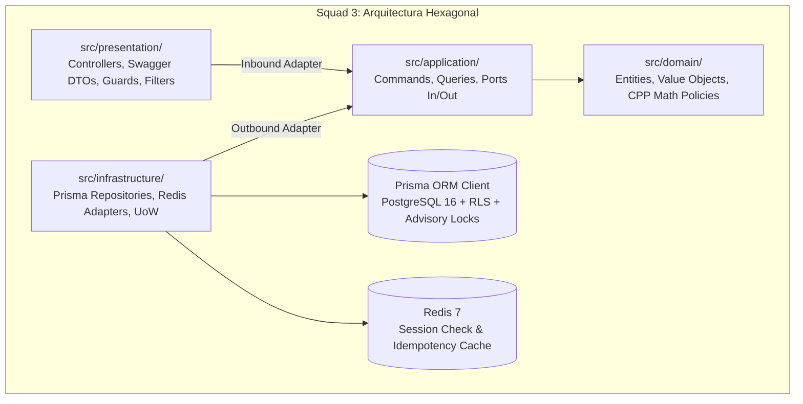
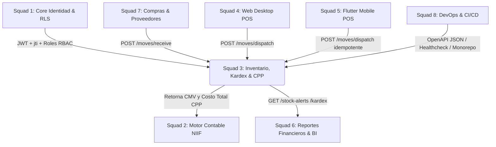
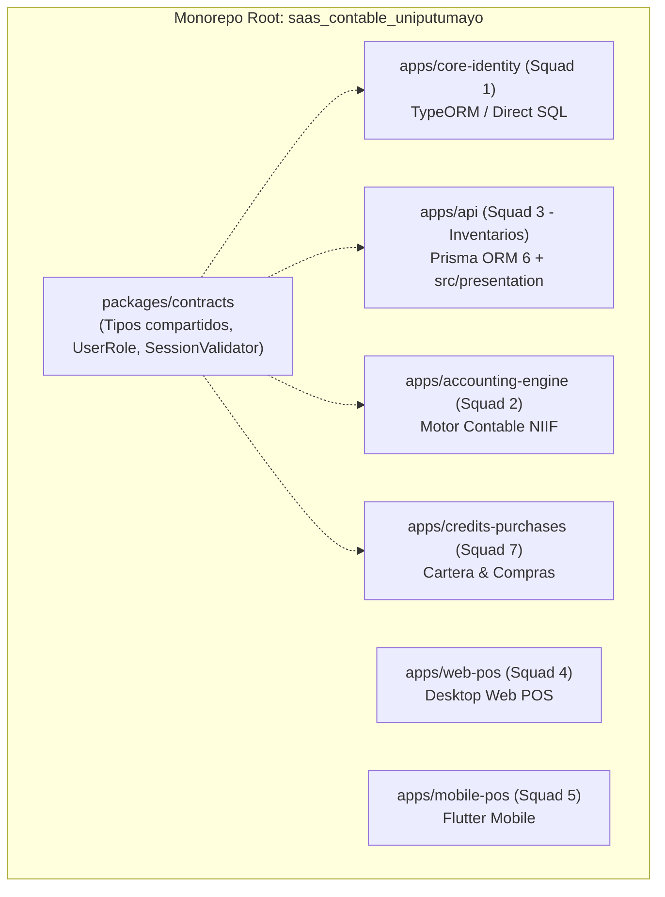

# GUÍA TÉCNICA Y DE INTEGRACIÓN — ESCUADRÓN 3
## Motor de Inventario, Kardex Multi-Bodega & Costo Promedio Ponderado (CPP)

Esta guía técnica está diseñada para que los demás escuadrones del ecosistema (**Squad 1 - Core/Auth**, **Squad 2 - Contabilidad NIIF**, **Squad 4 - Web POS/Admin**, **Squad 5 - Mobile POS**, **Squad 6 - Reportes**, **Squad 7 - Compras/Cartera** y **Squad 8 - DevOps/Unificación Monorepo**) conozcan con precisión cómo funciona nuestro motor, cómo integrarse con él, qué endpoints consumir y qué lineamientos deben respetarse para el ensamblaje en el monorepo general.

---

### 1. ¿Qué hace nuestro módulo?

El **Escuadrón 3** es el **Motor Transaccional de Inventarios, Kardex y Costeo (CPP)** del SaaS Contable de UniPutumayo. Nuestro motor es la única fuente de verdad para:
1. **Control de Existencias Físicas:** Gestión de stock en tiempo real desglosado por bodega (`inventory_balances`).
2. **Cálculo del Costo Promedio Ponderado (CPP):** Algoritmo matemático estricto que actualiza el costo unitario de valuación de inventario con cada entrada de mercancía.
3. **Libro Mayor de Inventario (Kardex Inmutable):** Registro cronológico y determinista de cada entrada, salida, traslado y ajuste en `inventory_ledger_entries`.
4. **Despachos y Ventas:** Reducción de existencias físicas a valor de costo CPP, protegiendo el inventario contra saldos negativos mediante bloqueo pesimista (`SELECT FOR UPDATE`).
5. **Transferencias entre Bodegas:** Soporte para traslados inmediatos (`DIRECT`) y traslados en dos fases con mercancía en tránsito (`TWO_PHASE`).
6. **Tomas Físicas y Auditorías:** Apertura de conteos cíclicos y aplicación contable de ajustes por sobrantes y faltantes.
7. **Reversiones Compensatorias:** Anulación contable de movimientos erróneos sin borrado físico destructivo.

---

### 2. Decisiones Arquitectónicas Clave (Prisma ORM & Capa Presentation)

Para garantizar mantenibilidad, tipado seguro y alto rendimiento bajo principios de **Arquitectura Hexagonal**, el Escuadrón 3 adoptó dos decisiones estructurales fundamentales:



1. **Capa Inbound en `src/presentation`:**
   A diferencia de módulos que colocaron controladores dentro de infraestructura, el Squad 3 separó limpiamente los adaptadores de entrada en `src/presentation/controllers/inventory/` y `src/presentation/dtos/`. Esto aísla el protocolo HTTP y la documentación Swagger de la infraestructura de persistencia.
2. **Persistencia con Prisma ORM 6 (`prisma/schema.prisma`):**
   Utilizamos Prisma para modelar las entidades relacionales, generar tipos TypeScript estrictos y ejecutar transacciones interactivas con `prisma.$transaction`. En cada transacción se inyecta la variable de sesión RLS:
   ```sql
   SET LOCAL app.current_tenant_id = '<tenant_id>';
   ```
   Y se ejecutan bloqueos pesimistas de fila con `$queryRaw` (`SELECT ... FOR UPDATE`) sobre la tabla `inventory_balances` para prevenir condiciones de carrera concurrentes.

---

### 3. URL, Ambientes y Autenticación

#### 3.1 URLs Base

| Entorno | Base URL | Documentación Swagger UI |
| :--- | :--- | :--- |
| **Local Development** | `http://localhost:3000/api/v1` | `http://localhost:3000/api/docs` |
| **Producción / Despliegue** | `https://api.saascontable.uniputumayo.edu.co/api/v1` | `https://api.saascontable.uniputumayo.edu.co/api/docs` |

#### 3.2 Cabeceras de Petición Requeridas

Todas las peticiones entrantes deben incluir el token provisto por el sistema de identidad (**Squad 1**):

```http
Authorization: Bearer <TOKEN_JWT>
Content-Type: application/json
X-Idempotency-Key: <UUID_OPCIONAL_PARA_OPERACIONES_MUTABLES>
```

#### 3.3 Validación de Sesión y Roles (RBAC)

El Squad 3 no almacena usuarios ni contraseñas. Valida cada petición mediante:
1. Verificación criptográfica de firma JWT y expiración.
2. Comprobación en tiempo real en Redis (`session:<userId>:<jti> === 'active'`) consumiendo el puerto de Squad 1.
3. Extracción estricta del `tenantId` desde el payload del token (nunca desde parámetros ni cuerpos de petición).
4. Verificación de permisos según los roles estándar de `@saas/contracts`: `OWNER`, `ADMIN`, `INVENTORY_MANAGER`, `WAREHOUSE_KEEPER`, `ACCOUNTANT`, `AUDITOR`, `CASHIER`.

#### 3.4 Tokens de Prueba Rápidos para Swagger y Desarrollo Local

Para probar de inmediato la API en **Swagger UI** (`http://localhost:3000/api/docs`) sin necesidad de generar tokens JWT extensos ni autenticarse previamente contra el Escuadrón 1, el sistema reconoce directamente los siguientes tokens de prueba en el botón **Authorize**:

| Token a escribir en Swagger | Rol Asignado | Tenant ID | Usuario Simulado | Permisos Clave |
| :--- | :--- | :--- | :--- | :--- |
| `demo-121` o `demo-admin` | `ADMIN` | `a1111111-1111-4111-8111-111111111111` | Administrador Tenant A | **Acceso total**: crear productos, despachos, recepciones, transferencias, ajustes |
| `demo-owner` | `OWNER` | `a1111111-1111-4111-8111-111111111111` | Propietario Tenant A | **Acceso total** gerencial |
| `demo-warehouse` | `WAREHOUSE_MANAGER` | `a1111111-1111-4111-8111-111111111111` | Jefe de Bodega Tenant A | Recepción, despacho, transferencias, consulta de stock |
| `demo-cashier` | `CASHIER` | `a1111111-1111-4111-8111-111111111111` | Cajero POS Tenant A | Solo despacho de ventas (`POST /moves/dispatch`) y consulta de stock |

*(Nota: Estos tokens se encuentran activos exclusivamente en entornos de desarrollo y pruebas locales; en producción `NODE_ENV === 'production'` se valida estrictamente el JWT emitido con sesión Redis).*

---

### 4. Catálogo Completo de Endpoints (14 Operaciones)

#### 4.1 Dominio: Catálogo de Productos (`/api/v1/inventory/products`)

##### `POST /api/v1/inventory/products`
- **Propósito:** Crea un producto en el catálogo con su variante principal y límites de stock.
- **Roles:** `ADMIN`, `INVENTORY_MANAGER`.
- **Consumidores:** Squad 4 (Admin Web), Squad 7 (Compras).
- **Request Body:**
```json
{
  "code": "PROD-ARROZ-01",
  "name": "Arroz Florhuila 1kg",
  "description": "Bolsa de arroz blanco 1000g",
  "sku": "SKU-ARR-001",
  "price": "4500.00",
  "costPrice": "3200.00",
  "minStock": "10.0000",
  "maxStock": "200.0000",
  "unitMeasure": "UNIT"
}
```
- **Response (`201 Created`):**
```json
{
  "id": "a1000000-0000-4000-8000-000000000001",
  "tenantId": "10000000-0000-0000-0000-000000000001",
  "code": "PROD-ARROZ-01",
  "name": "Arroz Florhuila 1kg",
  "sku": "SKU-ARR-001",
  "currentStock": "0.0000",
  "averageCost": "3200.00",
  "isActive": true
}
```

##### `GET /api/v1/inventory/products`
- **Propósito:** Lista productos con paginación y filtros opcionales (`search`, `category`, `isActive`, `page`, `limit`).
- **Roles:** `ADMIN`, `INVENTORY_MANAGER`, `WAREHOUSE_KEEPER`, `ACCOUNTANT`, `AUDITOR`.
- **Response (`200 OK`):** Arreglo de productos con metadatos de paginación (`total`, `page`, `limit`).

##### `GET /api/v1/inventory/products/:id`
- **Propósito:** Obtiene el detalle completo del producto, sus variantes y el desglose de existencias por bodega.
- **Roles:** Consulta general autorizada.

##### `PATCH /api/v1/inventory/products/:id`
- **Propósito:** Actualiza precios, descripción o estado de activación del producto.
- **Roles:** `ADMIN`, `INVENTORY_MANAGER`.

---

#### 4.2 Dominio: Bodegas (`/api/v1/inventory/warehouses`)

##### `GET /api/v1/inventory/warehouses`
- **Propósito:** Lista todas las bodegas activas del tenant para selección en despachos, compras y traslados.
- **Roles:** `ADMIN`, `INVENTORY_MANAGER`, `WAREHOUSE_KEEPER`, `ACCOUNTANT`, `AUDITOR`, `CASHIER`.
- **Response (`200 OK`):**
```json
[
  {
    "id": "w1000000-0000-4000-8000-000000000001",
    "name": "Bodega Principal Mocoa",
    "code": "BOD-01",
    "isArchived": false
  }
]
```

---

#### 4.3 Dominio: Movimientos de Entrada y Salida (`/api/v1/inventory/moves`)

##### `POST /api/v1/inventory/moves/receive` (Recepción de Mercancía)
- **Propósito:** Registra ingreso físico por compra a proveedor o entrada manual y **recalcula automáticamente el Costo Promedio Ponderado (CPP)**.
- **Roles:** `ADMIN`, `INVENTORY_MANAGER`, `WAREHOUSE_KEEPER`.
- **Consumidores:** Squad 7 (Compras y Proveedores).
- **Request Body:**
```json
{
  "warehouseId": "w1000000-0000-4000-8000-000000000001",
  "productId": "a1000000-0000-4000-8000-000000000001",
  "quantity": "50.0000",
  "unitCost": "3400.00",
  "notes": "Factura Compra Prov-9876",
  "idempotencyKey": "idem-rec-001"
}
```
- **Response (`201 Created`):**
```json
{
  "movementId": "m1000000-0000-4000-8000-000000000001",
  "productId": "a1000000-0000-4000-8000-000000000001",
  "warehouseId": "w1000000-0000-4000-8000-000000000001",
  "type": "PURCHASE_RECEIPT",
  "quantity": "50.0000",
  "unitCost": "3400.00",
  "previousStock": "0.0000",
  "newStock": "50.0000",
  "previousAverageCost": "0.00",
  "newAverageCost": "3400.00",
  "createdAt": "2026-10-11T12:00:00Z"
}
```

##### `POST /api/v1/inventory/moves/dispatch` (Despacho / Venta de Mercancía)
- **Propósito:** Descarga inventario físico para ventas POS o consumo interno. Valida existencias disponibles bajo bloqueo pesimista y **devuelve el Costo de Mercancía Vendida (CMV)** a valor CPP para la causación en Squad 2.
- **Roles:** `ADMIN`, `INVENTORY_MANAGER`, `WAREHOUSE_KEEPER`, `CASHIER`.
- **Consumidores:** Squad 4 (Web POS), Squad 5 (Flutter Mobile POS).
- **Request Body:**
```json
{
  "warehouseId": "w1000000-0000-4000-8000-000000000001",
  "productId": "a1000000-0000-4000-8000-000000000001",
  "quantity": "5.0000",
  "notes": "Venta Factura POS-1024",
  "idempotencyKey": "idem-disp-001"
}
```
- **Response (`201 Created`):**
```json
{
  "movementId": "m2000000-0000-4000-8000-000000000002",
  "productId": "a1000000-0000-4000-8000-000000000001",
  "warehouseId": "w1000000-0000-4000-8000-000000000001",
  "type": "SALE_DISPATCH",
  "quantity": "5.0000",
  "unitCost": "3400.00",
  "totalCost": "17000.00",
  "previousStock": "50.0000",
  "newStock": "45.0000",
  "createdAt": "2026-10-11T12:05:00Z"
}
```

##### `POST /api/v1/inventory/moves/reverse` (Reversión Compensatoria)
- **Propósito:** Anula un movimiento previo (por devolución de cliente, anulación de factura o error de despacho) emitiendo un contra-movimiento auditado.
- **Roles:** `ADMIN`, `INVENTORY_MANAGER`.
- **Request Body:**
```json
{
  "movementId": "m2000000-0000-4000-8000-000000000002",
  "reason": "Cliente anuló compra POS-1024 en caja"
}
```
- **Response (`201 Created`):** Retorna el contra-movimiento de compensación con el saldo restaurado.

---

#### 4.4 Dominio: Transferencias entre Bodegas (`/api/v1/inventory/transfers`)

##### `POST /api/v1/inventory/transfers`
- **Propósito:** Inicia o ejecuta un traslado entre dos bodegas del mismo tenant.
- **Modalidades:**
  - `DIRECT`: Traslado inmediato (descuenta origen e ingresa en destino en la misma transacción).
  - `TWO_PHASE`: Descuenta origen y coloca las unidades en estado `IN_TRANSIT`.
- **Roles:** `ADMIN`, `INVENTORY_MANAGER`, `WAREHOUSE_KEEPER`.
- **Request Body:**
```json
{
  "sourceWarehouseId": "w1000000-0000-4000-8000-000000000001",
  "targetWarehouseId": "w2000000-0000-4000-8000-000000000002",
  "productId": "a1000000-0000-4000-8000-000000000001",
  "quantity": "10.0000",
  "type": "TWO_PHASE",
  "notes": "Despacho a sucursal Norte"
}
```

##### `POST /api/v1/inventory/transfers/:id/receive`
- **Propósito:** Da por recibida en bodega destino una transferencia que se encontraba en tránsito (`IN_TRANSIT` $\rightarrow$ `COMPLETED`).
- **Roles:** `ADMIN`, `INVENTORY_MANAGER`, `WAREHOUSE_KEEPER`.

---

#### 4.5 Dominio: Conteos Físicos y Ajustes (`/api/v1/inventory/stock-counts`)

##### `POST /api/v1/inventory/stock-counts`
- **Propósito:** Abre una sesión de auditoría física para una bodega.
- **Roles:** `ADMIN`, `INVENTORY_MANAGER`, `AUDITOR`.

##### `POST /api/v1/inventory/stock-counts/:id/apply`
- **Propósito:** Cierra la sesión de conteo comparando existencias teóricas del sistema contra cantidades físicas contadas, asentando ajustes por sobrantes (`ADJUSTMENT_IN`) y faltantes (`ADJUSTMENT_OUT`).
- **Roles:** `ADMIN`, `INVENTORY_MANAGER`.
- **Request Body:**
```json
{
  "items": [
    {
      "productId": "a1000000-0000-4000-8000-000000000001",
      "physicalQuantity": "42.0000"
    }
  ],
  "notes": "Auditoría mensual cierre de periodo"
}
```

---

#### 4.6 Dominio: Kardex y Alertas (`/api/v1/inventory/kardex`, `/stock-alerts`)

##### `GET /api/v1/inventory/kardex/:productId`
- **Propósito:** Retorna la bitácora histórica oficial del producto bajo método Costo Promedio Ponderado (entradas, salidas, saldos acumulados y costos unitarios de cada evento).
- **Roles:** Consulta general autorizada.

##### `GET /api/v1/inventory/stock-alerts`
- **Propósito:** Retorna el listado de productos cuyas existencias totales actuales son inferiores o iguales al stock mínimo configurado (`currentStock <= minStock`).
- **Roles:** Consulta general autorizada. Ideal para sugerir órdenes de compra en Squad 7.

---

### 5. Matriz de Integración Inter-Escuadrones



### Tabla de Responsabilidades e Interfaces

| Escuadrón | Misión del Escuadrón | Endpoints que consume de Squad 3 | Propósito de la Integración |
| :--- | :--- | :--- | :--- |
| **Squad 1** | Identidad, Multi-Tenant & RBAC | *Ninguno* | Proveedor de identidad. Squad 3 consume el contrato de tokens y sesión en Redis provisto por Squad 1. |
| **Squad 2** | Motor Contable NIIF | `GET /kardex/:productId` | Recibe de Squad 3 el dato del **Costo de Mercancía Vendida (CMV)** tras cada despacho para causar la cuenta 6135 (Costo) contra la 1435 (Inventario). |
| **Squad 4** | Web Desktop Admin & POS | `POST /moves/dispatch`<br>`GET /products`<br>`GET /warehouses` | Descarga inventario en tiempo real al facturar en caja y consulta existencias para validar disponibilidad antes del cobro. |
| **Squad 5** | Flutter Mobile POS | `POST /moves/dispatch` (con `idempotencyKey`) | Sincroniza despachos de ventas realizadas en modo offline sin riesgo de duplicar la salida física. |
| **Squad 6** | Reportes Financieros y BI | `GET /kardex/:productId`<br>`GET /stock-alerts` | Genera reportes de valoración de inventario, rotación de mercancía y alertas operativas de desabastecimiento. |
| **Squad 7** | Compras, Proveedores & Cartera | `POST /moves/receive`<br>`GET /stock-alerts` | Al asentar una factura de compra, invoca a Squad 3 para aumentar stock físico y recalcular el CPP; consulta alertas para compras sugeridas. |
| **Squad 8** | DevOps, SRE & CI/CD | `GET /api/docs`<br>`npm run openapi:export` | Automatiza healthchecks, monitorea pruebas E2E y unifica el código en el monorepo Turbo / pnpm. |

---

### 6. Contratos de Datos y Formato Numérico Obligatorio

Para evitar discrepancias en la integración, todos los escuadrones deben respetar las siguientes directrices de serialización JSON:

1. **Valores Numéricos como Strings Decimales:**
   Debido a que el motor de JavaScript presenta imprecisión binaria IEEE 754 (ej. `0.1 + 0.2 !== 0.3`), **todas las cantidades, precios y costos unitarios deben enviarse y recibirse como `string`**:
   - Cantidades: hasta 4 decimales (`"50.0000"`).
   - Precios y Costos: 2 decimales (`"3400.00"`).
2. **Formato UUID:** Todos los IDs (`productId`, `warehouseId`, `tenantId`, `movementId`) son cadenas UUID v4 en minúsculas.
3. **Unidades de Medida Permitidas:** `UNIT` (unidad), `KG` (kilogramo), `METER` (metro), `LITER` (litro), `PACKAGE` (paquete/bulto).

---

### 7. Qué DEBE Hacer y Qué NO DEBE Hacer una Squad Consumidora

#### Lo que SÍ DEBE hacer:
- **Consultar existencias antes de vender:** Invoque `GET /inventory/products/:id` para confirmar stock disponible antes de emitir una factura POS.
- **Enviar siempre `idempotencyKey`:** Especialmente desde POS móvil (Squad 5) o compras (Squad 7) para evitar duplicación de movimientos por micro-cortes de red.
- **Tomar el costo unitario de la respuesta de Squad 3:** Cuando Squad 4 o 5 despacha mercancía, la respuesta incluye el `unitCost` y `totalCost` calculados al CPP exacto del sistema. Envíe ese valor a Squad 2 para la causación contable.

#### Lo que NO DEBE hacer (Terminantemente Prohibido):
- **NO altere directamente las tablas de inventario:** Ningún escuadrón debe hacer `UPDATE inventory_balances` ni `INSERT INTO inventory_movements` por fuera de la API de Squad 3. Hacerlo destruye la trazabilidad contable del Kardex y corrompe el CPP.
- **NO calcule el Costo Promedio Ponderado por su cuenta:** La matemática del CPP es responsabilidad exclusiva del dominio del Squad 3.
- **NO envíe números como float primitivo de JSON:** Envíe siempre strings con formato decimal fijo (`"10.0000"`).
- **NO asuma que un despacho exitoso causó la contabilidad automáticamente:** Si la venta se descuenta en Squad 3 pero falla la red al llamar a Squad 2, la squad orquestadora debe solicitar la reversión a Squad 3 (`POST /moves/reverse`).

---

### 8. Pautas de Integración en el Monorepo para Squad 8 (DevOps & Unificación)

Esta sección guía a **Squad 8** y a cualquier **Agente IA** en la unificación de los 7 repositorios en un único monorepo Turbo / pnpm workspace:



1. **Ubicación de Capas en Squad 3:**
   - La API de inventarios utiliza **`src/presentation/`** como punto de entrada de controladores HTTP, DTOs y decoradores Swagger.
   - La persistencia utiliza **Prisma ORM** con su esquema en `prisma/schema.prisma`.
2. **Consumo de `@saas/contracts`:**
   - Squad 3 importa tipos transversales (`UserRole`, `AuthenticatedUser`, `SessionValidator`, `SESSION_VALIDATOR_PORT`) desde el paquete compartido del monorepo (`workspace:*`), garantizando acoplamiento mínimo y compatibilidad total con Squad 1.
3. **Base de Datos y RLS:**
   - La base de datos es compartida (`saas_contable_db`). En las migraciones de Squad 8, las tablas de Squad 3 (`products`, `inventory_balances`, `inventory_movements`, `inventory_ledger_entries`, `inventory_transfers`, `stock_counts`) tienen claves foráneas hacia `tenants` de Squad 1 y políticas RLS activas (`FORCE ROW LEVEL SECURITY`).
4. **Comandos Reproducibles para CI/CD:**
   - Compilación: `npm run build`
   - Validación de tipos: `npx tsc --noEmit`
   - Pruebas unitarias e integración: `npm test -- --testPathIgnorePatterns=test/e2e` (29 suites / 210 tests pasando).
   - Pruebas funcionales E2E contra Postgres y Redis: `npm run test:e2e` (35 escenarios aprobados).
   - Exportación de especificación OpenAPI: `npm run openapi:export` (genera `docs/openapi.json` y `swagger.json`).
